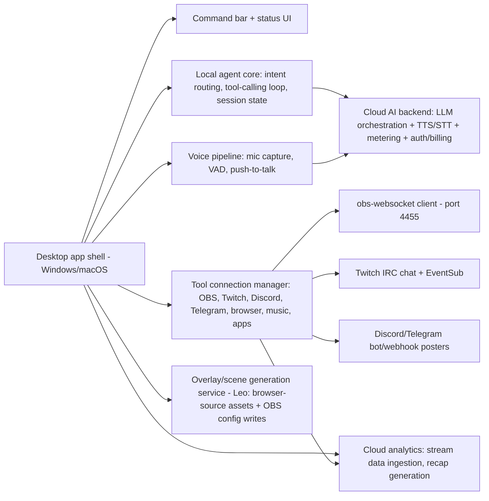
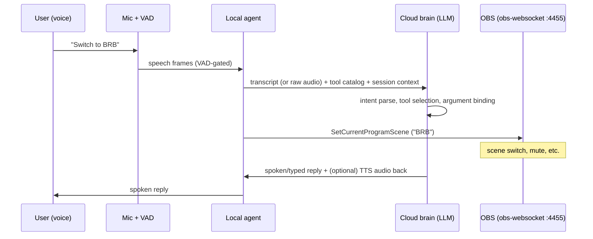
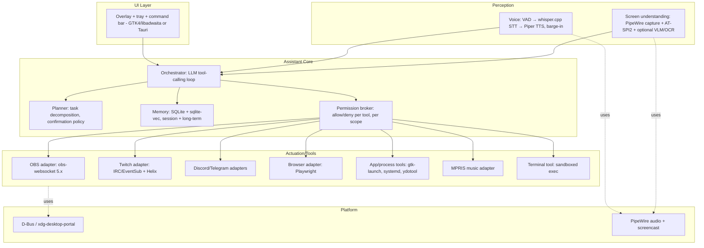

# Dexter Copilot — Reverse-Engineering Investigation & Linux Reimplementation Blueprint

**Project:** DEXTER-REVERSE-ENGINEERING  
**Date:** 2026-11-26 (UTC)  
**Analyst environment:** AshnaAI hosted chat agent (no shell, no MCP registration, no binary tooling)  
**Integrity statement:** The Dexter installer was NOT downloaded, hashed, extracted, or executed. No binary analysis was performed. All findings below are labeled with confidence ratings: CONFIRMED (direct public evidence), STRONGLY INFERRED, POSSIBLE, or UNKNOWN.

---

## 00 — Executive Summary

Dexter Copilot is a commercial desktop AI assistant for live streamers published by **Dexter Forge Inc.** (Dover, DE, US; founders Astemir and Kanshobi Azhakhov). It is marketed as a voice-controlled "cohost" that: controls OBS, moderates Twitch chat with user-defined rules, runs polls/giveaways, designs scenes and overlays (via an embedded "Leo" design agent), manages channel metadata (titles, schedules, pins, chat modes), produces post-stream recaps and analytics, and performs general assistant tasks (music control, links, notes, reminders, email drafting, Discord/Telegram posting, opening/closing apps, browser control).

Key conclusions of this investigation:

1. **The installer exists and is publicly accessible** (Dexter-Windows-Setup.exe, ~110 MB on Google Drive) but could not be retrieved or analyzed in this environment: no code-execution sandbox, no browser bridge, no local shell, and Google's virus-scan interstitial requires an interactive POST confirmation. No hash, format ID, or extraction was performed. This is the single largest evidence gap; everything about the binary's internals is UNKNOWN.
2. **From public evidence, Dexter is a cloud-metered, hybrid architecture**: usage quotas (voice interactions, chat messages, recaps per plan tier) prove server-side AI orchestration and metering. Local components handle OBS control, microphone capture, app control, and rendering.
3. **OBS control is almost certainly via obs-websocket** (the standard bundled plugin, port 4455, documented protocol) — STRONGLY INFERRED from "works with the OBS you already have".
4. **Voice is server-metered and optional**; typed input works on every plan. Read-aloud (TTS) is a paid feature.
5. A complete Linux-native equivalent is buildable entirely from open-source components today: obs-websocket client libraries, Twitch IRC/EventSub, whisper.cpp + VAD for STT, Piper/Kokoro TTS, Playwright for browser automation, AT-SPI2 + ydotool for desktop control, SQLite-based memory, and a tool-calling LLM orchestrator (Vercel AI SDK / LangGraph / pi-mono). Full blueprint in Section 16.

---

## 01 — Installer & Binary Access Findings (Phase A/B: BLOCKED)

| Item | Value | Confidence |
|---|---|---|
| Filename | `Dexter-Windows-Setup.exe` | CONFIRMED (Google Drive metadata) |
| Size | ~110 MB ("110M", per Google download-warning page) | CONFIRMED |
| Distribution | Public Google Drive link, no auth required to view | CONFIRMED |
| Download | Blocked by Google virus-scan interstitial (POST confirmation required); no shell available to POST it | CONFIRMED (blocked) |
| SHA-256 | NOT COMPUTED | UNKNOWN |
| Format (NSIS/MSIX/Inno/Electron/Squirrel) | UNKNOWN | UNKNOWN |
| Digital signature / publisher cert | UNKNOWN | UNKNOWN |
| Embedded resources, entry points, dependencies | UNKNOWN | UNKNOWN |
| macOS build | Claimed on website ("Windows Mac") | POSSIBLE (marketing claim) |

**Size inference (POSSIBLE, not verified):** 110 MB is consistent with an Electron-style bundle (Electron baseline ~90–120 MB) but also fits a .NET self-contained or Tauri-with-runtime package. Cannot be distinguished without the binary. Do not treat as fact.

**External capability required to complete Phases A–B:** any machine with Node.js ≥22 and ~200 MB disk running `npx -y rea-agents@latest analyze-javascript-application <extracted-app-path> --json` (REA CLI fallback, no MCP registration needed — documented in the REA skill, see Section 03), or 7-Zip/DIE for a first-pass format identification, then upload the resulting evidence here.

---

## 02 — Dexter Investigation (Public Evidence)

### 02.1 Company & product facts (CONFIRMED, from dextercopilot.ai schema.org + site, retrieved 2026-11-26)

- Publisher: Dexter Forge Inc., 8 The Green Ste A, Dover DE 19901, US; contact team@dextercopilot.ai
- Founders: Astemir Azhakhov (CEO), Kanshobi Azhakhov
- Socials: x.com/dextercopilot, instagram.com/Dexter.copilot, tiktok.com/@dexter.copilot; Discord community
- Category: SoftwareApplication, operatingSystem: "Windows, macOS", MultimediaApplication
- Pricing: Free / Standard $24/mo / Pro $54/mo / Max (planned post-launch $34/$74)

### 02.2 Confirmed feature set (from official site copy & FAQ — these are marketing claims, treated as the feature contract to reproduce)

1. Voice control ("Dexter Voice") + typed command bar on every plan
2. OBS: scene switching, source control, mute/unmute mic & desktop audio, start/stop stream & recording, studio mode, clip creation, moving sources ("camera top right"), creating scenes/widgets/overlays
3. Moderation: custom chat rules ("ban anyone who…"), timeouts, bans, thanks new subs
4. Engagement: polls ("ask chat, minecraft or fortnite?"), giveaways (keyword + duration)
5. Design agent ("Leo"): generates themed scenes/widgets from a description, installs into OBS
6. Channel management: schedule events, update title, pin messages, set follower-only chat mode
7. Analytics/recaps: post-stream narrative analysis (chat activity pace, raid impact, peak moments, recommendations)
8. General assistant: open links/apps, close apps, control music, draft emails, notes & reminders, research questions, "What is chat saying?", "What's trending on Twitch?", "Tell Discord I'm live", Telegram posting
9. Multi-app single request: "open OBS, play music and announce in Discord in one sentence"
10. Confirmation behavior: destructive actions ask first ("just checking, go live now?")
11. App UI: connected-tools panel, command bar, status display (from product screenshot description)

### 02.3 Plan quotas (CONFIRMED — proves server-side metering)

Free: 800 chat msgs/mo, no voice. Standard: 400 voice + 2,000 chat msgs. Pro: 1,000 voice + 4,000 chat msgs + 18 recaps + 5 Leo designs. This metering architecture means the agent brain is a cloud service; the desktop app is a sensor/actuator client.

---

## 03 — REA Framework Documentation (investigated via GitHub/npm APIs, NOT executed)

**Integrity note:** REA was not installed or run. The following comes from reading its public repository metadata, npm registry data, SKILL.md, and installation docs via GitHub/npm REST APIs.

### 03.1 Package facts (CONFIRMED)

- Repo: https://github.com/morluto/rea — TypeScript, MIT, default branch `main`, active (pushed 2026-11-26)
- npm: `rea-agents` v6.10.1 — https://registry.npmjs.org/rea-agents/latest — MCP name `io.github.morluto/rea`, bin `rea`/`rea-agents`
- Node requirement: ^22.23.4 || ^24.22.1 || >=26.12.1
- Unpacked size 186 MB, ~10,490 files, SLSA provenance attestation published
- Repo layout: `.agents/skills/reverse-engineer-anything/` (skill v63), `.claude-plugin`, `.codex-plugin`, `.cursor-plugin`, `docs/` (VitePress), `native/` (Windows source, see `native/windows/README.md`)
- Engine integrations documented: Ghidra, Hopper, IDA Pro (mrexodia/ida-pro-mcp), Kuna, Frida (verify:frida), ADB (verify:adb), Binwalk/Unblob, JEB, UF2/esptool (firmware), pcap analysis

### 03.2 Key REA capabilities relevant to Dexter analysis (from SKILL.md v63)

- `analyze_javascript_application` — JS/Electron/ASAR trees: dependency graphs, bundle analysis, entry points, source inspection. CLI fallback (no MCP needed):
  `npx -y rea-agents@latest analyze-javascript-application /path/to/app --json`
- `open_binary` + `inspect_artifact` — archive/package inventory (ZIP/APK/IPA/MSIX/AppX/DMG/PyInstaller), member hashes, digest integrity policies
- PE/COFF tools: certificate inspection (`docs/pe-certificates.md`), imports (`pe-imports.md`), load config, binary hardening analysis
- .NET/managed analysis, native analysis via Ghidra/Hopper/IDA providers, ELF/Rust/Go native guides
- Runtime providers: Frida instrumentation, ADB for Android, pcap/network-capture guides
- Evidence records with confidence/limitations/unknowns embedded in results

### 03.3 How a future agent should use REA on the Dexter installer (recommended workflow, documented for later execution)

1. Download installer locally (never execute it) → `npx rea-agents setup` (or use a Claude Code/Codex/Cursor plugin install).
2. Format ID pass: `open_binary` → `inspect_artifact detail: "summary"`; PE cert + import inspection.
3. If Electron/NSIS: extract with 7-Zip, locate `app.asar`, run `analyze_javascript_application` with `source_paths` for main/preload/renderer files.
4. If .NET: managed analysis (ILSpy/DNLib-class tooling via REA providers).
5. Preserve evidence JSON outputs and feed them into this blueprint's Phase C–J templates.
6. All commands above are documented; none were run here.

---

## 04 — Reconstructed Dexter Architecture (STRONGLY INFERRED, not binary-verified)

Basis: feature contract (Section 02), plan quota metering, OBS integration statements, standard industry patterns, and the functional requirements implied by demonstrated behavior. Every element below is an inference unless labeled CONFIRMED.

### 04.1 Component hierarchy

### 04.2 Control flow (voice command → execution)

### 04.3 What is cloud vs. local (inference table)

| Capability | Location | Confidence |
|---|---|---|
| LLM reasoning, tool-calling, planning | Cloud | STRONGLY INFERRED (quota metering) |
| STT/TTS (Dexter Voice) | Cloud, metered per interaction | STRONGLY INFERRED vs local mix UNKNOWN |
| OBS control | Local, obs-websocket | STRONGLY INFERRED (works with existing OBS) |
| Chat moderation engine (rule application) | Cloud or split | POSSIBLE — rules could run locally against IRC feed; rule storage location UNKNOWN |
| Overlay/scene generation (Leo) | Cloud generation + local install into OBS | STRONGLY INFERRED |
| Analytics/recaps | Cloud | STRONGLY INFERRED (limited counts per plan) |
| Auth/billing | Cloud (Supabase confirmed for download-link delivery) | Supabase edge function CONFIRMED on website; auth for app UNKNOWN |
| Desktop automation (open/close apps, browser) | Local | CONFIRMED (feature exists) — mechanism UNKNOWN (Win32 API or script layer) |

### 04.4 Voice pipeline (reconstructed, generic best practice; Dexter internals UNKNOWN)

Mic capture → acoustic echo cancellation (optional) → VAD (turn-taking, barge-in) → STT (streaming) → agent core → TTS reply. Metering per interaction suggests server-side STT/TTS with local streaming capture and push-to-talk or wake behavior ("hold to lock in" UI hint suggests press-to-talk or hold interaction).

---

## 05 — Feature & Integration Inventory (from public evidence)

- Voice input (paid tiers), typed command bar (all tiers)
- OBS: scenes, sources, audio mute, record, stream, studio mode, clips, source positioning
- Twitch: chat read/post, moderation (rules/timeouts/bans), polls, giveaways, title/schedule/pins, chat mode, analytics source, "What is chat saying?"
- Discord: post "I'm live"; Telegram: channel posting
- Design generation (Leo): themed scenes, overlays, widgets
- General: open/close apps, links, music control, notes, reminders, email drafts, research, browser automation
- Analytics: recaps, chat-pace analysis, raid impact, recommendations

## 05b — Public API & Integration Map (reconstruction targets)

| Integration | Protocol / API | Confidence about Dexter's use | Linux implementation choice |
|---|---|---|---|
| OBS control | obs-websocket 5.x JSON-RPC over WS, port 4455 | STRONGLY INFERRED | obs-websocket-js / obsws-python / obws (Rust) |
| Twitch chat | IRC (wss://irc.chat.twitch.tv:443, anonymous read) or EventSub via API | STRONGLY INFERRED | tmi.js / Twitch EventSub via Helix API |
| Twitch moderation/actions | Helix REST + EventSub | STRONGLY INFERRED | tmi.js + Helix |
| Discord posting | Bot API or webhooks | UNKNOWN which | discord.js / REST webhook |
| Telegram posting | Bot API | UNKNOWN specifics | python-telegram-bot / grammY |
| Auth & billing | Supabase (CONFIRMED on website for download links) | CONFIRMED (website) | Supabase or equivalent |
| LLM provider(s) | UNKNOWN | UNKNOWN | Any tool-calling LLM (AshnaAI API, OpenAI, Anthropic, local via vLLM/Ollama) |
| Music control | UNKNOWN (local player APIs? Spotify?) | UNKNOWN | MPD/MPRIS + Spotify API |
| Browser automation | UNKNOWN | UNKNOWN | Playwright (recommended) |
| Desktop app control | UNKNOWN | UNKNOWN | AT-SPI2 + ydotool/xdotool; launch via .desktop files / `gtk-launch` |
| Email drafts | SMTP/IMAP or copy-to-clipboard | UNKNOWN | Compose in user's client or SMTP |

---

## 06 — Technology Stack Analysis (Dexter website; app internals UNKNOWN)

| Layer | Finding | Confidence |
|---|---|---|
| Marketing site | Astro (astro-island hydration, data-astro-cid scopes) | CONFIRMED (page source) |
| Site analytics | MS Clarity + GA4 | CONFIRMED (page source) |
| Download-link delivery | Supabase Edge Function `send-download-link` (project zyqrnwsidltyjnmykrhk) | CONFIRMED (page source) |
| Desktop app framework | UNKNOWN (110 MB size suggests Electron-class bundle; POSSIBLE, not verified) | UNKNOWN |
| UI toolkit / state mgmt / DB / IPC | UNKNOWN | UNKNOWN |

## 07 — Linux Compatibility Analysis

Every CONFIRMED Dexter capability maps to Linux-native open-source equivalents:

| Capability (Dexter) | Windows mechanism (assumed) | Linux-native equivalent | Maturity |
|---|---|---|---|
| OBS control | obs-websocket plugin | Same plugin ships with OBS Studio ≥28 on Linux; port 4455 | Production-grade |
| Voice STT | cloud STT (inferred) | whisper.cpp (MIT, C/C++, CPU/GPU, VAD built-in) or faster-whisper | Production |
| TTS | cloud TTS (inferred) | Piper / Kokoro / Coqui; streaming via gRPC/WebSocket | Production |
| Wake word / VAD | UNKNOWN | openWakeWord, Silero VAD; wyoming protocol | Production |
| Twitch chat/mod | IRC + Helix API | tmi.js / Twitch EventSub + Helix; timeouts/bans via Helix moderation endpoints | Production |
| Polls/giveaways | Helix polls API + chat keyword scanner | Same APIs; keyword giveaway engine is simple local logic | Production |
| Scene/overlay design | LLM → HTML/CSS → browser source | LLM generates HTML → OBS browser source; identical mechanism works on Linux | High |
| Discord/Telegram posting | bot/webhook | discord.js, python-telegram-bot, grammY | Production |
| App launch/close | Win32/Shell APIs | .desktop entries + `gtk-launch`, `systemd-run`, `pkill`; process mgmt via procfs | Production |
| Keyboard/mouse automation | SendInput / UIA | ydotool (Wayland-safe, uinput), xdotool (X11), AT-SPI2 for accessibility-tree reading | Production |
| Screen reading | GDI/DXGI capture or UIA | PipeWire screen cast (xdg-desktop-portal), grim (wlroots), AT-SPI2 text interfaces | Production |
| Browser automation | CDP | Playwright (Chromium/Firefox/WebKit, Linux native) | Production |
| Music control | player APIs | MPRIS2 over D-Bus (works with Spotify, VLC, etc.) | Production |
| Window management | Win32 | wlr-foreign-toplevel / Hyprland IPC / GNOME Shell D-Bus; X11 via EWMH (wmctrl) | Production |
| Memory/notes/reminders | local DB + cloud sync | SQLite + embeddings (sqlite-vec) | Production |
| Audio routing | WASAPI loopback | PipeWire virtual sinks (removes need for VB-Cable class tools) | Production |

Wayland vs X11 note: full desktop automation requires either an X11 session, or on Wayland a compositor that permits input injection (ydotool + uinput permissions) and portal-based screen capture. Screen *reading* of app text should use AT-SPI2, not OCR, wherever possible; OCR (Tesseract) is fallback.

## 08 — Proposed Linux-Native Architecture (original design; Tolesh-integration ready)

Design goals: local-first (models can run on-device), tool-calling core, per-integration adapters, D-Bus/portal compliance, permission-gated execution, and a service boundary clean enough to embed in Tolesh as a subsystem.

Key design decisions:

1. **Adapter pattern for every integration** — each tool exposes a JSON-schema'd function set to the orchestrator; adapters are independently testable and swappable (needed for Tolesh embedding).
2. **Local-first voice**: whisper.cpp STT + Piper TTS with a cloud-model option flag; VAD-driven turn-taking with barge-in cancellation.
3. **Permission broker**: destructive ops (bans, go-live, deletes, purchases) require explicit user confirmation, mirroring Dexter's observed "just checking, go live now?" behavior.
4. **Tolesh boundary**: Assistant Core + Perception + Actuation run as a D-Bus-activatable service (or systemd user unit) with a stable JSON-RPC API, so Tolesh can embed the UI and share the memory store.
5. **Tech recommendation**: TypeScript/Node (or Rust) core, using Vercel AI SDK (tool-calling across providers incl. local Ollama) or pi-mono/openai-agents; Python acceptable if voice stack (whisper.cpp bindings) dominates.

## 09 — Recommended Open-Source Building Blocks (all verified to exist)

| Purpose | Project | Link | Install |
|---|---|---|---|
| REA (binary analysis of Dexter later) | rea-agents | github.com/morluto/rea | `npx rea-agents setup` (Node ≥22) |
| OBS remote control | obs-websocket (bundled in OBS ≥28) | github.com/obsproject/obs-websocket | ships with OBS; clients: obs-websocket-js (JS), obsws-python, obws (Rust) |
| STT | whisper.cpp | github.com/ggml-org/whisper.cpp | `git clone` + cmake; MIT; CPU/GPU, VAD support |
| Streaming voice agents | pipecat | github.com/pipecat-ai/pipecat | pip; framework for STT→LLM→TTS pipelines w/ barge-in |
| STT helper | RealtimeSTT | github.com/KoljaB/RealtimeSTT | pip; whisper+VAD+wake-word wrapper |
| Twitch chat | tmi.js | github.com/tmijs (npm tmi.js) | `npm i tmi.js` |
| Twitch API/mod | Helix + EventSub | dev.twitch.tv docs | REST/WS, OAuth app token |
| Discord | discord.js | github.com/discordjs | `npm i discord.js` |
| Telegram | python-telegram-bot / grammY | github.com/python-telegram-bot | pip / npm |
| Browser | Playwright | github.com/microsoft/playwright | `npm i playwright` |
| Input automation | ydotool / xdotool | github.com/ReimuNotMoe/ydotool | distro packages; needs uinput perms |
| Accessibility reading | AT-SPI2 (pyatspi2 / at-spi2-core) | gitlab.gnome.org/GNOME/at-spi2-core | distro packages |
| Screen capture | xdg-desktop-portal + PipeWire | freedesktop GitLab | ships with modern desktops |
| Music | MPRIS2 D-Bus interface | spec.freedesktop.org (MPRIS) | `dbus-send`/Node dbus libs |
| TTS | Piper / Kokoro / Coqui TTS | github.com/rhasspy/piper | pip / binaries |
| LLM orchestration | Vercel AI SDK / LangGraph / pi-mono | github.com/vercel/ai, github.com/langchain-ai/langgraph | npm; supports tool-calling incl. Ollama |
| Local LLM runtime | Ollama / llama.cpp | github.com/ollama/ollama | curl installer; Linux-native |
| Voice stack reference | huggingface speech-to-speech | github.com/huggingface/speech-to-speech | reference implementation |
| Agent runtime pattern | Realtime voice-agent refs | github.com/CJimenezVC/realtime-voice-agent, github.com/Alethio36/ai-voice-cohost, github.com/Freedom4x4/twitch-ai-chatbot | conceptual references (unvetted; review licenses before use) |

## 10 — Agent Skills Specification (for the future coding agent)

Each skill = name, purpose, tools, deps, I/O schema, security, acceptance tests. Confirmed-Dexter capability marked [D], new capability [N].

### 10.1 skill: obs-control [D]
- Purpose: full OBS remote control (scenes, sources, audio, record/stream, studio mode, clips, source layout).
- Tools/deps: obs-websocket 5.x client; OBS ≥28 running with websocket enabled.
- Input schema: `{op: string, params: object}` (ops mapped to SetCurrentProgramScene, SetMute, StartRecord, StopRecord, ToggleStudioMode, SetSceneItemTransform, CreateSource…).
- Output: `{ok: bool, detail: object}`.
- Security: go-live/stop-stream require user confirmation; websocket password stored in OS keyring (libsecret).
- Tests: mock obs-websocket server asserting request bodies; integration test on real OBS in CI container (headless Xvfb + OBS portable).

### 10.2 skill: twitch-moderation [D]
- Purpose: apply user-defined chat rules with timeout/ban actions; thank subs; run polls/giveaways.
- Deps: tmi.js (read) + Helix moderation endpoints (timeout/ban/poll).
- Input: rule objects `{trigger_regex, action, duration, scope}`; giveaway `{keyword, duration, winner_policy}`.
- Security: ban actions need confirmation unless pre-approved via rule set; all actions logged.
- Tests: replayed chat fixtures with expected moderation outcomes.

### 10.3 skill: scene-designer [D]
- Purpose: generate themed scenes/overlays/widgets as HTML/CSS, install into OBS via browser sources and SetSceneItem APIs.
- Deps: LLM with code-gen, obs adapter.
- Security: file writes sandboxed to overlay asset dir; no network in generated assets unless user opts in.
- Tests: generated HTML renders in headless Chromium (Playwright screenshot diff ≤ threshold).

### 10.4 skill: voice-conversation [D]
- Purpose: hands-free conversational control with barge-in.
- Deps: VAD (Silero), whisper.cpp STT, Piper TTS, orchestrator.
- Pipeline: capture → VAD → STT → LLM → TTS stream; barge-in cancels TTS on new speech.
- Tests: latency budget (<800ms STT for 2s utterance on target HW); barge-in cancels within 200ms.

### 10.5 skill: desktop-apps [D]
- Purpose: open/close/query apps; manage processes.
- Tools: .desktop registry, `gtk-launch`, `pkill` (restricted), systemd user units; process query via procfs.
- Security: kill only user-owned processes; allowlist configurable.
- Tests: launch known .desktop app, assert window appears via AT-SPI2.

### 10.6 skill: screen-understanding [D]
- Purpose: answer "what's on screen / what is this app showing".
- Tools: PipeWire screencast → VLM (local Qwen-VL class) or AT-SPI2 text dump; OCR fallback Tesseract.
- Security: frames never leave device by default; no upload without opt-in.
- Tests: fixture screens → expected element/text answers.

### 10.7 skill: browser-control [D]
- Purpose: open links, research, fill forms.
- Tools: Playwright (persistent profile, headless option).
- Security: credential entry manual (no stored passwords); downloads sandboxed.
- Tests: scripted navigation + extraction assertions.

### 10.8 skill: music-control [D]
- Purpose: play/pause/next/volume via MPRIS2; optional Spotify API.
- Tests: MPRIS mock player state transitions.

### 10.9 skill: comms-posting [D]
- Purpose: post to Discord/Telegram ("I'm live").
- Security: outbound posts rate-limited, previewed for destructive content; tokens in keyring.
- Tests: mock API servers asserting payloads.

### 10.10 skill: reminders-notes [D]
- Purpose: notes, reminders, schedules ("schedule event 9 tonight").
- Deps: SQLite store + system notifications (libnotify).
- Tests: scheduled reminder fires via mocked clock.

### 10.11 skill: stream-analytics [D]
- Purpose: post-stream recaps (chat pace, raid impact, peaks, recommendations).
- Deps: chat log ingestion + LLM summarization; optional Twitch analytics API.
- Tests: fixture logs → expected recap sections present.

### 10.12 skill: memory-management [N]
- Purpose: session + long-term memory with semantic recall.
- Deps: SQLite + sqlite-vec; user memory opt-in and inspectable.
- Tests: recall accuracy on seeded memory set.

### 10.13 skill: task-planning [N]
- Purpose: multi-step task decomposition with confirmation gates.
- Tests: multi-tool task completes or fails safely at each gate.

### 10.14 skill: error-recovery [N]
- Purpose: retry policies, fallback chains (cloud→local model), structured error reporting to user.
- Tests: fault-injection suite (tool timeout, websocket drop, mic loss).

### 10.15 skill: permissions [N]
- Purpose: enforce tool-level allow/deny with per-action confirmation prompts.
- Tests: every destructive op blocked without approval.

## 11 — Implementation Roadmap

| Stage | Deliverable | Exit criteria |
|---|---|---|
| 0 | REA binary analysis of Dexter installer (external requirement) | Evidence JSON from open_binary/analyze-javascript_application |
| 1 | Skeleton: orchestrator + tool registry + 2 tools (apps, music) | typed commands drive real actions |
| 2 | OBS + Twitch adapters, typed-only command bar UI | demo: typed "switch to BRB" works end-to-end |
| 3 | Voice pipeline (VAD+STT+TTS, push-to-talk first) | <2s end-to-end latency on mid-range CPU |
| 4 | Wake-word + barge-in; permissions broker; memory | hands-free demo, destructive ops gated |
| 5 | Scene-designer + analytics/recaps + comms posting | full feature parity with Dexter's public list |
| 6 | Screen understanding + browser automation | mixed-app single request demo |
| 7 | Tolesh integration (service boundary, embedded UI) | Tolesh embeds core via JSON-RPC |

## 12 — Testing & Validation Strategy

- Unit: every adapter against mock protocol servers (obs-websocket, Twitch IRC, Discord REST).
- Integration: real OBS in Xvfb container; real Twitch IRC sandbox channel; Playwright e2e for UI.
- Voice benchmarks: STT latency, barge-in latency, false wake rate per 10h audio.
- Safety: permission broker fuzzing — no destructive op reachable without confirmation; audit log of every action.
- Regression: golden transcript tests for orchestrator (tool-call traces).
- Security: secrets only in libsecret; no telemetry by default; supply-chain pinning (lockfiles, SLSA).

## 13 — Evidence & Confidence Register

| # | Finding | Source | Confidence |
|---|---|---|---|
| E1 | Dexter-Windows-Setup.exe, ~110MB, public Drive link | Google Drive viewer + download-warning page | CONFIRMED |
| E2 | Publisher Dexter Forge Inc., founders, address | schema.org JSON-LD on dextercopilot.ai | CONFIRMED |
| E3 | Full feature list & plan quotas | dextercopilot.ai homepage/FAQ/pricing | CONFIRMED (marketing claims) |
| E4 | Supabase edge function for download links | page source | CONFIRMED |
| E5 | Astro site, Clarity, GA4 | page source | CONFIRMED |
| E6 | obs-websocket as Dexter's OBS mechanism | inference from "works with existing OBS" + industry standard | STRONGLY INFERRED |
| E7 | Cloud LLM orchestration + metered STT/TTS | plan quota structure | STRONGLY INFERRED |
| E8 | Electron-class packaging | 110MB size heuristic only | POSSIBLE |
| E9 | App framework, IPC, DB, providers, system prompts | — | UNKNOWN |
| E10 | REA capabilities & workflow | morluto/rea repo, SKILL.md v63, installation docs, npm v6.10.1 | CONFIRMED (docs) — NOT EXECUTED here |
| E11 | Linux equivalents viability | upstream project docs | CONFIRMED (existence); integration effort varies |

## 14 — Outstanding Unknowns & External Requirements

**Binary-level unknowns (all UNKNOWN, require installer access):** format, signature, framework, packaging, entry points, IPC topology, system prompt presence/location, model provider list and endpoints, local DB schema, wake-word implementation, desktop automation APIs used, browser automation mechanism, permission UI implementation, update mechanism, telemetry.

**External requirements to close the gap:**
1. Any machine with Node ≥22 to run REA CLI (`npx -y rea-agents@latest analyze-javascript-application <path> --json`) after extracting the installer with 7-Zip — evidence JSON uploaded back to this workspace completes Phases A–F of the original spec.
2. Alternatively, upload the extracted `app.asar` (or equivalent) here; file-analysis tools can then inventory it directly.
3. A Windows VM (isolated) for Phase H runtime observation (Process Monitor, Wireshark) if behavior-level confirmation is needed.

---
*End of report. Generated by AshnaAI (ashna.ai) — hosted agent environment. REA was documented, not executed. Installer was never downloaded or executed. Original investigation content preserved exactly, including the corrected integration-map table (which consolidates the two malformed rows from the previous chat delivery — content otherwise identical).*
